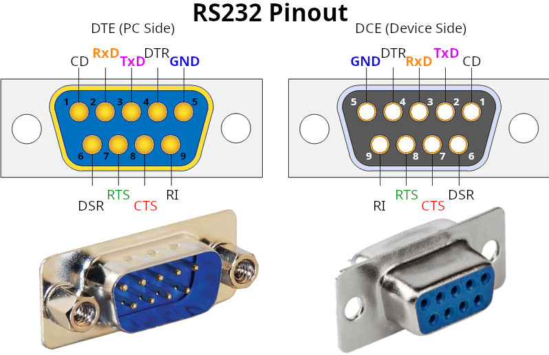
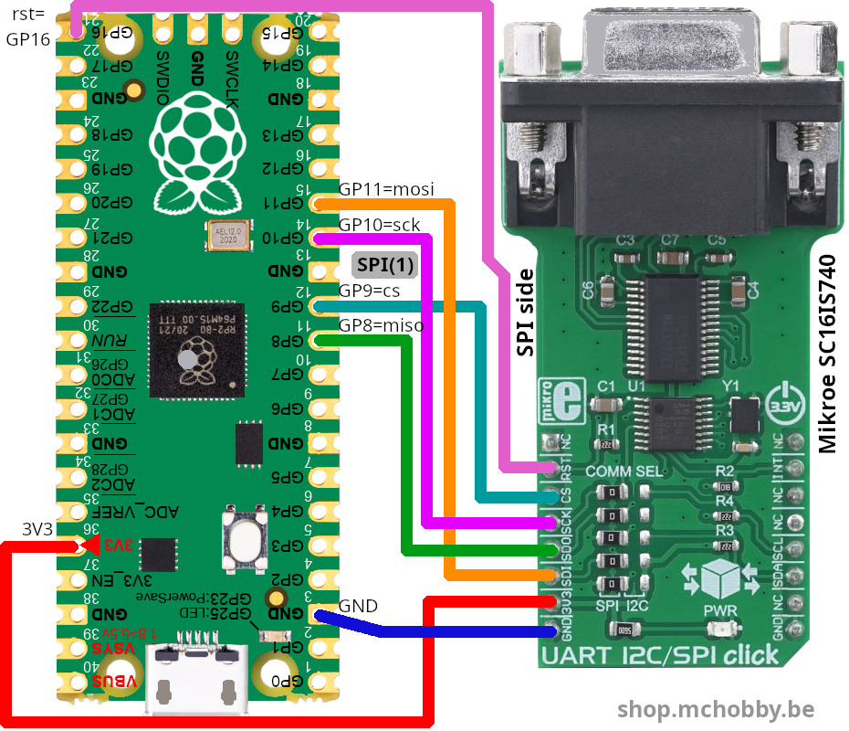
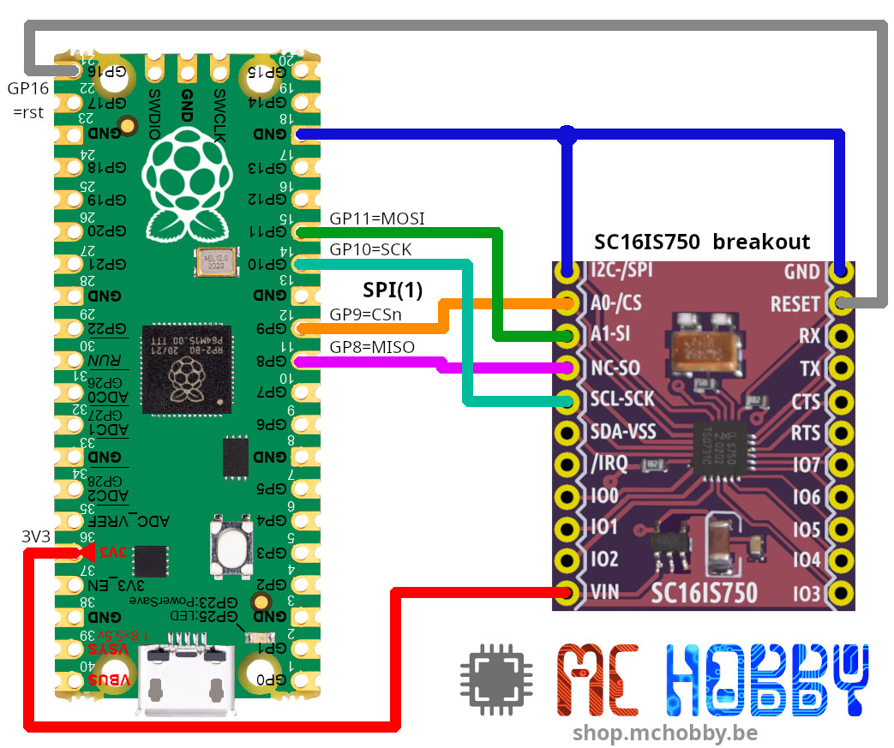
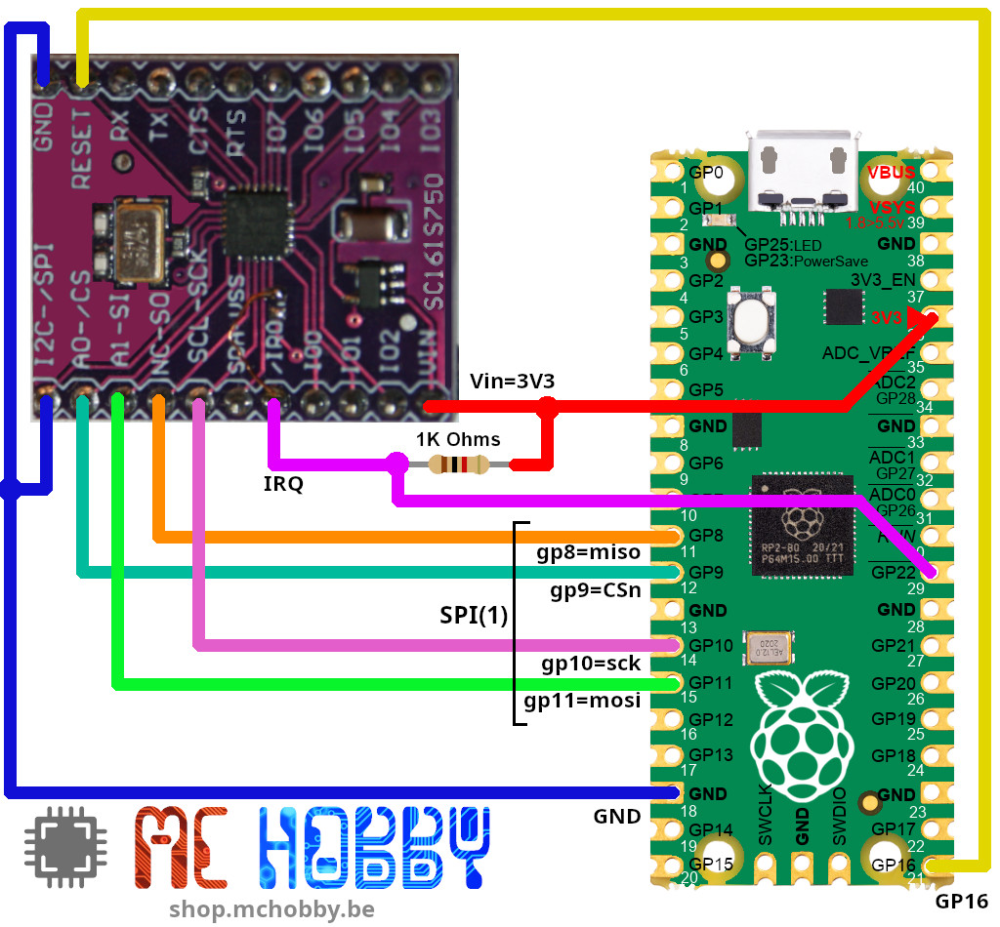
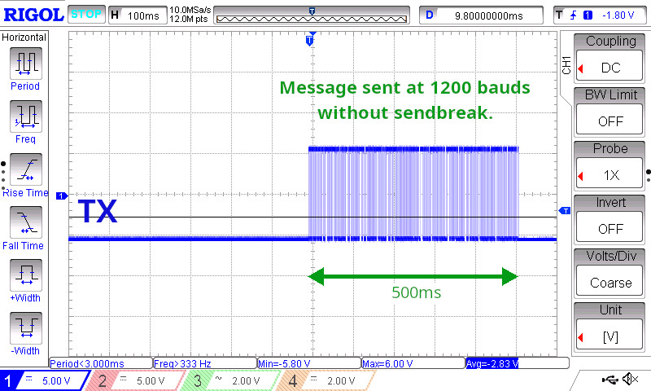
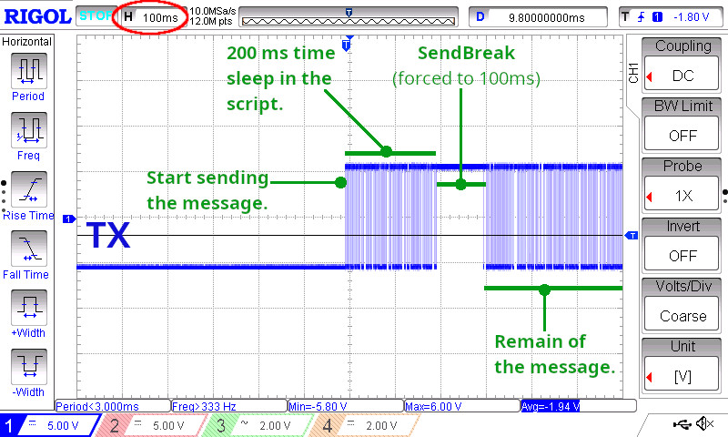
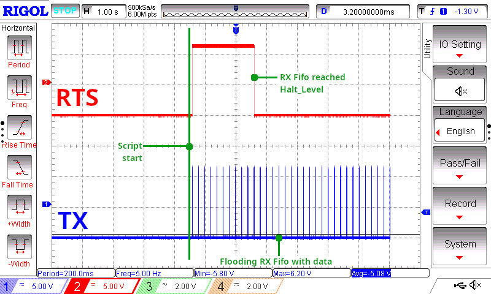
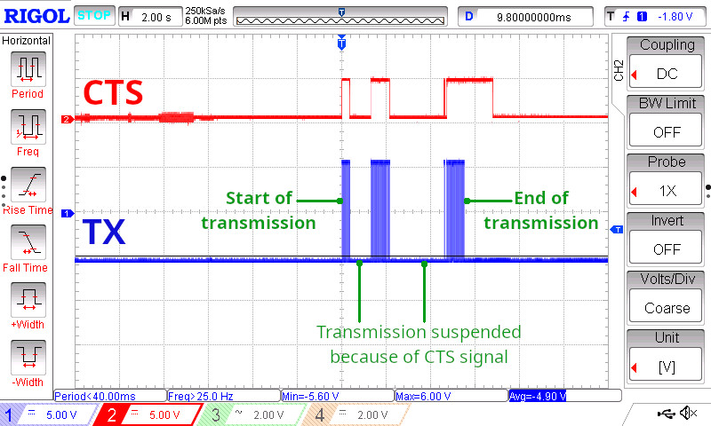
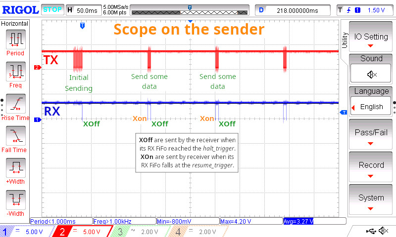

[Ce fichier existe également en FRANCAIS](readme.md)

# SPI/I2C to Serial Interface for MicroPython

This driver cover the SPI mode for the following components:

* SC16IS740IPW : one UART
* SC16IS750 : one UART + 8 GPIOs. SPI @ 4 Mb/S max.
* SC16IS760 : one UART + 8 GPIOs. SPI @ 15 Mb/S max.

# Library

The library must be copied on the MicroPython board before using the examples.

On a WiFi capable plateform:

```
>>> import mip
>>> mip.install("github:mchobby/esp8266-upy/sc16is7xx")
```

Or via the mpremote utility :

```
mpremote mip install github:mchobby/esp8266-upy/sc16is7xx
```


# Wiring

## Pico to MicroE SC16IS740 (RS232)
The MicroE use a MAX3237 transceiver and expose a DB9 female connector.



We use the following SPI bus Wiring from a Pico



## Pico to SC16IS740/SC16IS750 breakout (UART)

The following picture shows a SC16IS750 wired to a Pico. Note that Reset signal is optional.



The following wiring shows how to attach the IRQ pin to the MCU.




# Examples

## Basics

The [test_sc16is740_basic.py](examples/spi/test_sc16is740_basic.py) examples shows all the basic script instruction to send and receive data over the serial line.

The SC16IS7xx UART offers the same interface that __machine.UART__ class so instanciated object could be used in place of a MicroPython UART.

## Readline

The example use a GPS Ultimate to grab data lines emited by the GPS receiver.

The [test_sc16is740_readline.py](examples/spi/test_sc16is740_readline.py) examples shows how to use the UART's `readline` method. Readline returns a `bytearray` object displayed as it and also converted to string.

Here follows an excerpt of the output as stored into [test_sc16is740_readline.result](examples/spi/test_sc16is740_readline.result) .

```
bytearray(b'$GPGGA,004212.000,5041.4423,N,00424.0377,E,1,03,3.20,102.6,M,47.4,M,,*69\r\n')
$GPGGA,004212.000,5041.4423,N,00424.0377,E,1,03,3.20,102.6,M,47.4,M,,*69

bytearray(b'$GPGSA,A,2,08,02,10,,,,,,,,,,3.35,3.20,1.00*0D\r\n')
$GPGSA,A,2,08,02,10,,,,,,,,,,3.35,3.20,1.00*0D

bytearray(b'$GPGSV,1,1,03,08,73,193,35,02,68,285,30,10,42,054,31*4F\r\n')
$GPGSV,1,1,03,08,73,193,35,02,68,285,30,10,42,054,31*4F
```

## Extra

The [test_sc16is740_extra.py](examples/spi/test_sc16is740_basic.py) examples shows adavanced features all the basic script instruction to send and receive data over the serial line.

Advanced functions are:

* __any()__ : check number of chars in the RX FIFO.
* __any_tx()__ : check number of chars in the TX FIFO.
* __txdone()__ : check if there is still data to be send.
* __fush()__ : wait all the data to be sent.
* __sendbreak()__ : send a break condition on the TX line.

## Sendbreak

The sendbreak is a special use-case holding the TX signal for longer than the time required to send single character.

The [test_sc16is740_rts.py](examples/spi/test_sc16is740_rts.py) sends a message at 1200 bauds, which takes about 500ms. 



Once the message sent to the TX FIFO, the scripts waits 200ms and finally send a long break forced to 100ms. This sendnreak should falls right in the message sending!



## Auto-RTS activation

Testing  UART auto-RTS output signal feature requires the following wiring:

* Set TX --> RX  loopback
* wire scope to TX
* Wire scope to RTS

The [test_sc16is740_rts.py](examples/spi/test_sc16is740_rts.py) activates the AUTO-RTS then flood the RX Fifo with messages.

The example defines the __halt_trigger__ to halt transmission and __resume_trigger__ to resume transmission. Both must in the range 4..64 bytes by step of 4 bytes.

Which produce the following signals:



RTS (Ready To Send) is an output pin!

It informs the remote when data can be send (HIGH=send, LOW=halt).

* RTS goes LOW when Receive FIFO reach the "halt_trigger", the remote must halt transmission.
* RTS goes HIGH when Receive FIFO falls to the "resume_trigger" and stays below the "halt_trigger". The remote can send data.

## Auto-CTS activation

The Auto-CTS deactivates the TX transmission when CTS is set to HIGH by an external signal.

Testing  UART auto-CTS input signal feature requires the following wiring:

* wire scope to TX
* Wire scope to CTS
* A wire with 1K resistor connected to CTS pin will set the level either to to 5V (HIGH), either GND (will be LOW).

The [test_sc16is740_cts.py](examples/spi/test_sc16is740_cts.py) activates the AUTO-CTS. 

The scripts sends a long stream at 300 bauds which takes about 4 seconds. This laps is enough to manipulate the CTS signal by hand.

Here a scope capture of the test.



## Auto-XOn/XOff

The [test_sc16is740_xon_xoff.py](examples/spi/test_sc16is740_xon_xoff.py) activates the __Auto Software Workflow control__ (so with XON/XOFF).

The script is executed as sender (set `IS_SENDER=True`) on one board. The other board execute the same script as receiver (set `IS_SENDER=False`).
Finaly the scope is used to monitor the TX & RX pin on the sender, showing the xon/xoff in action.



## GPIO handling

The SC16IS750/760 do have GPIOs that can be configured either as input (no pull-up/down available), either as output.

See the following examples for more details:

* [test_sc16is750_read_pin.py](examples/spi/test_sc16is750_read_pin.py) : configure an IO as input then read its state.
* [test_sc16is750_write_pin.py](examples/spi/test_sc16is750_write_pin.py) : configure an IO as output then change its state.
* [test_sc16is750_irq_pin.py](examples/spi/test_sc16is750_irq_pin.py) : get an interrupt when input signal changes.

## Interrupt Signal

The SC16IS7xx also expose an IRQ pin that can be used with the MCU to get informed on special conditions. 

See this [IRQ wiring example](docs/_static/sc16is750-irq-to-pico.jpg) used with the following examples scripts.

Note: Configure IRQ may sometime be difficult. The library include the most usual cases.

* [test_sc16is750_irq_pin.py](examples/spi/test_sc16is750_irq_pin.py) : get an interrupt when input signal changes.
* [test_sc16is750_irq_rxtx.py](examples/spi/test_sc16is750_irq_rxtx.py) : get an interrupt when rx/tx FIFO reach a given Level. Only demonstrate IRQ capture and IRQ source.


## Another oscillator?

The SC16IS7XX base class use the default 1.8432 MHz oscillator. 

The [test_sc16is740_osc.py](examples/spi/test_sc16is740_osc.py) shows how to instanciate the class when the oscillator clocks at another frequency.