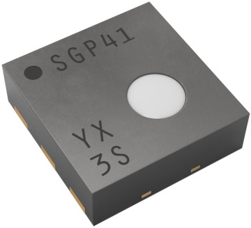
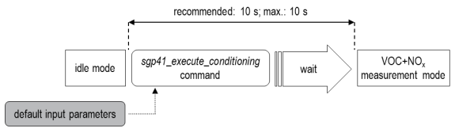
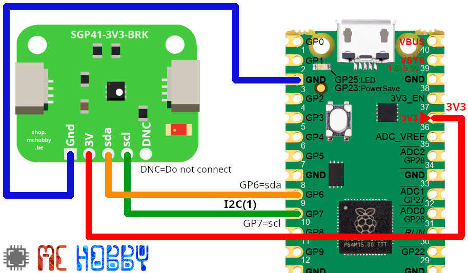

[This file also exists in ENGLISH](readme_ENG.md)

# SGP41 - Capteur VoC, NOx de qualité d'air via I2C avec MicroPython

Le SGP41 est un capteur de gaz numérique basé sur la technologie MOx (Metal Oxyde, une plaque chauffante).
Ce capteur a pour fonction de mesurer la qualité de l'air intérieur en détectant les COV (composés organiques volatils) et les NOx (oxydes d'azote). Ce composant est idéal pour des projets liés à la qualité de l'air, tels que les purificateurs d'air, les systèmes de climatisation ou les installations de ventilation.



La bibliothèque retourne les valeur `raw_VOC` et `raw_NOx` dans la gamme 0..65535 .

Notez que le relevé NOx est disponible seulement après la phase de conditionnement du MOx. Ce conditionnement prend exactement 10 secondes.



Après le conditionnement, la mesure NOx est disponible. 

Idéalement, il est préférable d'__optimiser la compensation__ en fournissant des relevés de l'humidité relative et de la température (sinon c'est les valeurs par défaut qui sont utilisées).


La température et humidité relative peuvent être mesurés à l'aide d'un capteur SHT4x .

## Gas Index 

Sensirions propose l'algorithme __Gaz Index__ (voir [implementation Arduino](https://github.com/Sensirion/arduino-gas-index-algorithm)) pour transformer la lecture brute en "index" pratique à lire.

Cet algorithme n'est pas disponible pour MicroPython... après inspection, il apparaît que le portage représente un quantité de travail demesurée (si vous cherchez un projet...).

Par conséquent le calcul d'index n'est pas disponible dans ce dépôt.

# Bibliothèque
La bibliothèque doit être copiée sur votre carte MicroPython avant d'utiliser les exemples.

Sur une plateforme WiFi:

```
>>> import mip
>>> mip.install("github:mchobby/esp8266-upy/sgp4x")
```

Ou avec l'utilitaire mpremote :

```
mpremote mip install github:mchobby/esp8266-upy/sgp4x
```

# Brancher 
Le raccordement est facile. 

Le SGP41 utilise une interface I2C pour transmettre les donncées VoC et NOx.

Le libellé __DNC__ signifie " _Do Not Connect_ " pour "Ne pas connecter"

## SGP41 avec Raspberry-Pi Pico

Agrandir l'image pour pour lire les différents libellés.



# Tester

Rapellez vous que l'élément chauffant MOx doit être pré-conditionné pendant 10 secondes avant de pouvoir faire l'acquisition du NOx.

## Acquisition de données

Le script [test_sgp41.py](examples/test_sgp41.py) lit les données du capteur SGP41.

Le contenu est assez simple. Un bloc try..finally fait en sorte de désactiver le capteur en cas de problème durant la phase de conditionnement.

``` python
from machine import I2C, Pin
from sgp41 import SGP41
import time

# bus I2C du RaspberryPi Pico
i2c = I2C( 1, sda=Pin(6), scl=Pin(7) )
# Capteur
sgp = SGP41( i2c, address=0x59 )

sn = sgp.serial_number
print('Numero de serie:', sn )

print('Self test...')
sgp.self_test()
print('OK!')

rh_default = 50 # Humidité relative = 50%
t_default = 25  # temperature = 25 C

try:
  # Durant le pre-conditionnement, seul le relevé VoC est disponible
  # Conditionement durant 10 sec MAX (sinon il pourrait dégrader le capteur)
  start_ms = time.ticks_ms()
  while time.ticks_diff(time.ticks_ms(), start_ms) < 10_000 :
    raw_voc = sgp.conditioning( rh_default, t_default )
    print( 'raw voc:', raw_voc )
    time.sleep_ms(500)
    
  # Lecture de Voc & NOx reading (ce qui arrete le conditionnement)
  while True:
    # Il est possible d'avoir une meilleur compensation NOx
    # en fournissant les données réelle rh et t.
    raw_voc, raw_nox = sgp.measure_raw( rh_default, t_default )
    print( 'raw voc:', raw_voc, 'raw NOx:', raw_nox )
    time.sleep_ms(1000)
finally:
  # Entrer en mode Idle (arrête le conditionnement)
  print( 'Eteind le chauffage du MOx' )
  sgp.heater_off()
```

Ce qui produit le résultat suivant:

```
$ mpremote run examples/test_sgp41.py 
Numero de serie: 131100685
Self test...
OK! 
raw voc: 0
raw voc: 24181
raw voc: 24951
raw voc: 25363
raw voc: 25649
raw voc: 25862
raw voc: 26035
raw voc: 26179
raw voc: 26302
raw voc: 26418
raw voc: 26517
raw voc: 26601
raw voc: 26680
raw voc: 26754
raw voc: 26809
raw voc: 26886
raw voc: 26928
raw voc: 26991 raw NOx: 17882 
raw voc: 27110 raw NOx: 17941 
raw voc: 27188 raw NOx: 17693 
raw voc: 27261 raw NOx: 17523 
raw voc: 27331 raw NOx: 17408 
raw voc: 27366 raw NOx: 17305 
raw voc: 27430 raw NOx: 17231 
raw voc: 27487 raw NOx: 17152
raw voc: 27527 raw NOx: 17091 
raw voc: 27559 raw NOx: 17041
raw voc: 27617 raw NOx: 16988
raw voc: 27648 raw NOx: 16936
raw voc: 27677 raw NOx: 16901
raw voc: 27718 raw NOx: 16864
raw voc: 27732 raw NOx: 16813
raw voc: 27768 raw NOx: 16784
raw voc: 27799 raw NOx: 16752
raw voc: 27820 raw NOx: 16728
raw voc: 27852 raw NOx: 16689
raw voc: 27864 raw NOx: 16658
```

# Liste d'achat

* [SGP41 breakout](https://shop.mchobby.be/fr/cartes-breakout/2997-sgp41-capteur-cov-et-nox-qualite-d-air-3232100029972-mchobby.html) @ MCHobby

# Ressources utiles

* [Sensirion_i2c_sgp4x for Python](https://sensirion.github.io/python-i2c-sgp4x/api.html#) (Sensirion)
* [arduino-i2c-sgp41](https://github.com/Sensirion/arduino-i2c-sgp41) (Sensirion)
* [Sensirion Gas Index Algorithm](https://github.com/Sensirion/gas-index-algorithm) (Sensirion, Github)
* [Sensirion Gas Index Algorithm Arduino Library](https://github.com/Sensirion/arduino-gas-index-algorithm) (Sensirion, Github)