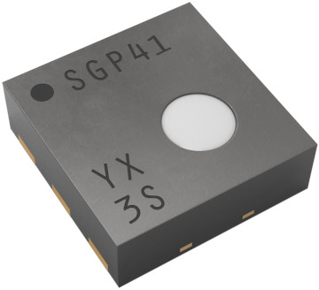
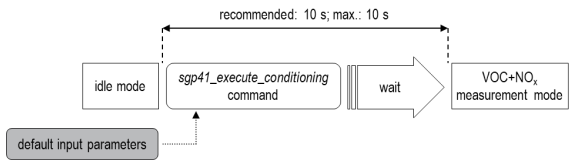
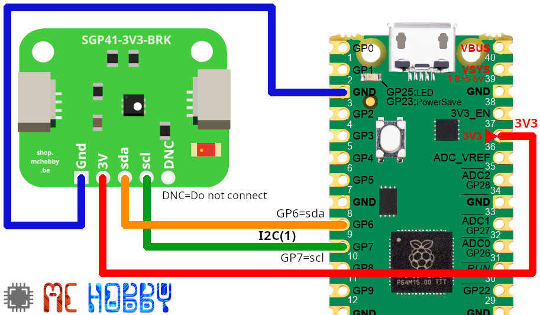

[Ce fichier existe également en FRANCAIS](readme.md)

# SGP41 - Air Quality Sensor VoC, NOx over I2C with MicroPython

The SGP41 is a MOx (Hot Plate) based digital gas sensors. 
It's main purpose is to measure the indoor air quality with VoC & NOx measurement. This device is great for air quality project like air purifier, air conditionning, ventillation system.



The library returns `raw_VOC` and `raw_NOx` values are in the range 0..65535 .

Note that NOx is available only after the conditionning of the MOx. This conditioning takes exactly 10 seconds.



After conditioning, the NOx value is available. 

The best is to __optimise the compensation__ by providing the real relative humidity and real temperature (otherwise it uses the default).


Temperature & Relative Humidity can be measured with an SHT4x sensor.

## Gas Index 

Sensirions offers the __Gaz Index__ algorithm (see [Arduino implementation](https://github.com/Sensirion/arduino-gas-index-algorithm)) to transform raw reading into useful index.

This algorithm is not available for MicroPython... after inspection, the portage may represent an impressive amount of work (if you need an idea...).

So Index calculation is not available.

# Library 
The library must be copied on the MicroPython board before using the examples.

On a WiFi capable plateform:

```
>>> import mip
>>> mip.install("github:mchobby/esp8266-upy/sgp4x")
```

Or via the mpremote utility :

```
mpremote mip install github:mchobby/esp8266-upy/sgp4x
```

# Wiring 
The wiring is quite simple. 

The SGP41 use an I2C interface for reading the VoC & NOx values.

The DNC pad stand for "Do Not Connect"

## SGP41 with Raspberry-Pi Pico

Enlarge the picture to read labels on the SGP41 breakout.



# Testing

Remember that MOx plate must be conditionned for 10 sec before acquiring the first NOx value.

## Reading values 

The [test_sgp41.py](examples/test_sgp41.py) script just read the value returned by SGP41.

Content is pretty straightforward. A try..finally block is used to ensure sensor power-off in case of trouble in the the conditionning phase.

``` python
from machine import I2C, Pin
from sgp41 import SGP41
import time

# I2C bus on RaspberryPi Pico
i2c = I2C( 1, sda=Pin(6), scl=Pin(7) )
# Sensor
sgp = SGP41( i2c, address=0x59 )

sn = sgp.serial_number
print('Serial Number:', sn )

print('Self test...')
sgp.self_test()
print('passed!')

rh_default = 50 # Relative Humidity = 50%
t_default = 25  # temperature = 25 C

try:
  # During conditionning, only VoC reading available
  # Conditionning for 10 sec MAX (otherwise it may degrade sensor)
  start_ms = time.ticks_ms()
  while time.ticks_diff(time.ticks_ms(), start_ms) < 10_000 :
    raw_voc = sgp.conditioning( rh_default, t_default )
    print( 'raw voc:', raw_voc )
    time.sleep_ms(500)
    
  # Start Voc & NOx reading (which stop conditionning)
  while True:
    # we can obtain better NOx compensation when providing real data for rh & t.
    raw_voc, raw_nox = sgp.measure_raw( rh_default, t_default )
    print( 'raw voc:', raw_voc, 'raw NOx:', raw_nox )
    time.sleep_ms(1000)
finally:
  # Go to Idle mode (be sure the conditionning is halted)
  print( 'Turn Heater Off' )
  sgp.heater_off()
```

which produce the following results:

```
$ mpremote run examples/test_sgp41.py 
Serial Number: 131100685
Self test...
passed! 
raw voc: 0
raw voc: 24181
raw voc: 24951
raw voc: 25363
raw voc: 25649
raw voc: 25862
raw voc: 26035
raw voc: 26179
raw voc: 26302
raw voc: 26418
raw voc: 26517
raw voc: 26601
raw voc: 26680
raw voc: 26754
raw voc: 26809
raw voc: 26886
raw voc: 26928
raw voc: 26991 raw NOx: 17882 
raw voc: 27110 raw NOx: 17941 
raw voc: 27188 raw NOx: 17693 
raw voc: 27261 raw NOx: 17523 
raw voc: 27331 raw NOx: 17408 
raw voc: 27366 raw NOx: 17305 
raw voc: 27430 raw NOx: 17231 
raw voc: 27487 raw NOx: 17152
raw voc: 27527 raw NOx: 17091 
raw voc: 27559 raw NOx: 17041
raw voc: 27617 raw NOx: 16988
raw voc: 27648 raw NOx: 16936
raw voc: 27677 raw NOx: 16901
raw voc: 27718 raw NOx: 16864
raw voc: 27732 raw NOx: 16813
raw voc: 27768 raw NOx: 16784
raw voc: 27799 raw NOx: 16752
raw voc: 27820 raw NOx: 16728
raw voc: 27852 raw NOx: 16689
raw voc: 27864 raw NOx: 16658
```

# Shopping List

* [SGP41 breakout](https://shop.mchobby.be/fr/cartes-breakout/2997-sgp41-capteur-cov-et-nox-qualite-d-air-3232100029972-mchobby.html) @ MCHobby

# Ressources

* [Sensirion_i2c_sgp4x for Python](https://sensirion.github.io/python-i2c-sgp4x/api.html#) (Sensirion)
* [arduino-i2c-sgp41](https://github.com/Sensirion/arduino-i2c-sgp41) (Sensirion)
* [Sensirion Gas Index Algorithm](https://github.com/Sensirion/gas-index-algorithm) (Sensirion, Github)
* [Sensirion Gas Index Algorithm Arduino Library](https://github.com/Sensirion/arduino-gas-index-algorithm) (Sensirion, Github)