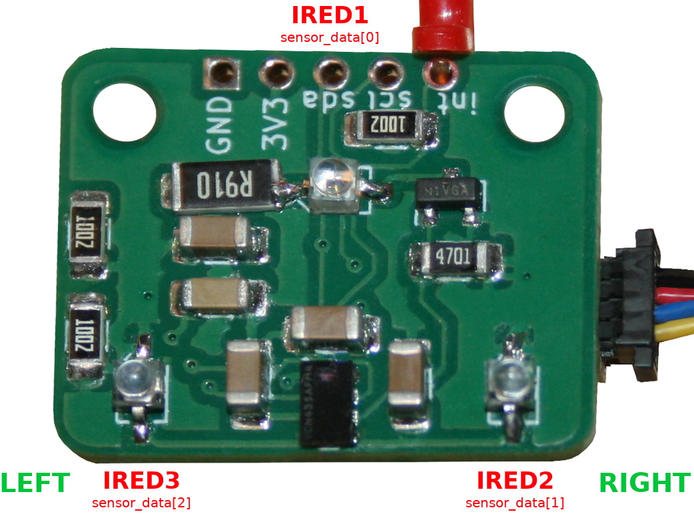
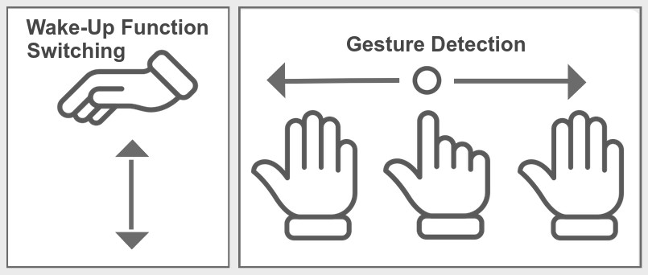
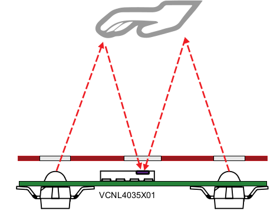
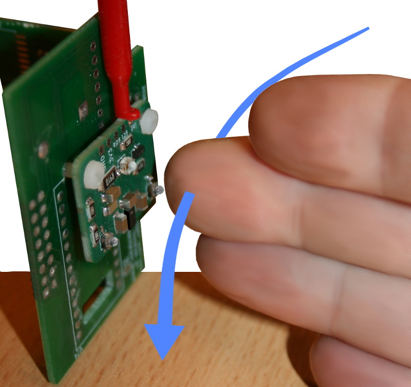
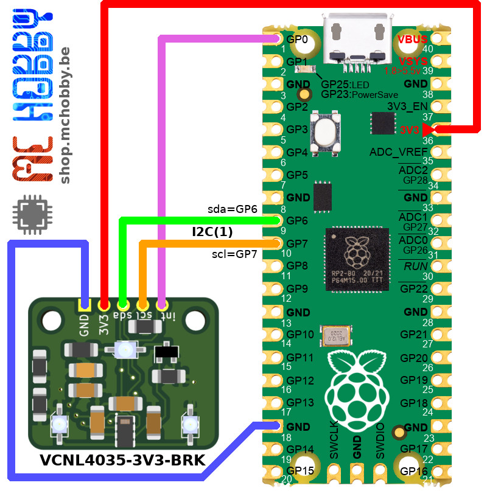
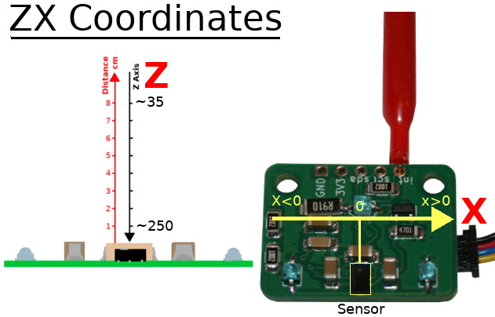

[This file also exists in ENGLISH here ](readme_ENG.md)

# VCNL4035: capteur de proximité et mouuvement avec MicroPython

VCNL4035X01 est un détecteur I2C intégrant un capteur de proximité (PS), un capteur de lumière ambiante (ALS) et des pilotes pour 3 LED infrarouges externes (nommées IRED).



Le capteur de lumière ambiante offre une résolution de 16 bits tandis que le capteur de proximité propose une résolution de 12/16 bits. Le capteur prend en charge les perturbations causées par la lumière ambiante, ainsi que la gestion des seuils et la génération d'interruptions (programmables).

Le capteur dispose également d'une immunité  à la lumière rouge (> 890 nm IREDs), variation de lumière fluorescente. Le courant des LEDs infrarouges et temps d'integration. 

La détection de mouvement (_Gesture_) est l'application la plus impressionnante possible avec ce capteur.



Ce capteur est idéal dans les applications suivantes: applications:

* Appareil portables (tablette/scanner)
* Applications industrielles
* Détecteur de proximité
* Detecteur de geste (_Gesture_)
* Application en milieu hygiénique
* Capteur de force (mesure de distance d'une surface reflechissante apposée sur un support déformable soumis à une force).

Grâce aux multiples LEDs, ce capteur est capable d'effectuer des acquisitions avancées



L'exemple applicatif [test_read_gesture.py](examples/app/test_read_gesture.py) est une implémentation élémentaire de détection des _swipes_ (proche du capteur) et _push_ (déplacer la main vers le capteur)



Exemple qui produit les résultats suivants sur la sortie REOM

```
PUSH detected
PUSH detected
SWIPE_RIGHT detected
SWIPE LEFT detected
SWIPE_RIGHT detected
SWIPE LEFT detected 
``` 

# Bibliothèque

 La bibliothèque doit être copiée sur la carte MicroPython avant de pouvoir exécuter les divers exemples.

La bibliothèque MicroPython inclus quelques implémentation des _notes applicatives_.

Sur une plateform WiFi:

```
>>> import mip
>>> mip.install("github:mchobby/esp8266-upy/vcnl4035")
```

Ou via l'utilitaire MPRemote :

```
mpremote mip install github:mchobby/esp8266-upy/vcnl4035
```

# Brancher

Le branchement correspond à un raccordement I2C standard. Le connecteur Qwiic/StemmaQT permet de brancher rapidement le capteur. 

Les applications avancées aurons besoin que le signal d'interruption (int) soit également branché sur le MicroControleur.



# Exemples
Les exemples sont scindés en deux groupes:

* __examples/basic/__ : [exemples fondamentaux](examples/basic) tester les fonctionnalités du VCNL4035.
* __examples/app/__ : [exemples applicatifs](examples/app) mettant en oeuvre des fonctionnalités avancées avec le VCNL4035.

Pour comprendre ces exemples, il est important de maitriser les coordonnées ZX.



# Limitation

* Support le basculement entre les modes _Proximity Sensor_ et _Ambient Light Sensor_.
* Implémenter le mode d'économie d'énergie (_low power_) dans VCNL App.

# Liste d'achat

* [VCNL40035 breakout](https://shop.mchobby.be/fr/proximite-distance/2878-vcnl4035-capteur-de-proximite-et-gesture-3232100028784-mchobby.html) est disponible chez MCHobby
